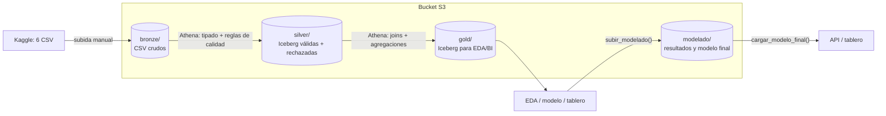

# outliers-churn-medallion

Arquitectura **Medallion (bronce → plata → oro)** sobre **AWS S3 + Athena + Apache Iceberg** para el
*Customer Churn Prediction Dataset V2 (500K)* de Kaggle. Proyecto Integrador 1 · Maestría en Ciencia de Datos y
Analítica · Universidad EAFIT · equipo **The Outliers**.

Esta base deja los datos limpios, auditados y consolidados para el **EDA** y el modelado de churn. Sobre ella están
el EDA, el **modelo de churn** (un EBM) y su **explicabilidad**.
También cubre la **Parte A** del Trabajo 1 (capas Medallion) del curso *Almacenamiento y Procesamiento de Grandes Datos*.

> Datos sintéticos (licencia Apache 2.0). Autor: Kuldeep Jangra. Los CSV **no** se versionan en este repo.

## Arquitectura



| Capa | Qué contiene | Formato | Base en Athena |
|---|---|---|---|
| **Bronce** | Los 6 CSV tal cual, **todas las columnas como texto** | CSV (tabla externa) | `churn_bronze` |
| **Plata** | Por cada tabla: filas **válidas** tipadas (+ columnas `flag_*`) y filas **rechazadas** con su motivo | Iceberg / Parquet | `churn_silver` |
| **Oro** | `customer_360` (1 fila por cliente) + agregados de negocio | Iceberg / Parquet | `churn_gold` |

## Estructura del repositorio

```
outliers-churn-medallion/
├── README.md
├── docs/
│   ├── 01_aws_setup_paso_a_paso.md       # guía de la consola de AWS desde cero
│   ├── 02_conexion_aws.md                # conectarse desde Python con el usuario compartido
│   ├── reglas_de_calidad.md              # catálogo de reglas (generado) para justificar con hallazgos
│   ├── comparacion_bronce_plata_oro.md   # plantilla de bytes escaneados y tiempos
│   ├── eda_decisiones.md                 # bitácora de decisiones del EDA, con su evidencia
│   ├── modelado_decisiones.md            # bitácora de decisiones del modelado y la explicabilidad
│   ├── 03_api_despliegue.md              # API, tabla churn_predicciones y despliegue en EC2
│   └── 04_tablero_streamlit.md           # guía del tablero: qué hace y cómo se lee cada vista
├── sql/
│   ├── 00_setup/        # crea las 3 bases de datos
│   ├── 01_bronze/       # tablas externas + verificación de conteos
│   ├── 02_hallazgos/    # tabla de defectos de calidad medidos en bronce
│   ├── 03_silver/       # 6 scripts: vista de validación + válidas + rechazadas
│   ├── 04_gold/         # customer_360, orders_monthly_category, churn_by_dimension
│   ├── 05_checks/       # conteos que cuadran, motivos, banderas, comparación de capas
│   └── 99_reset/        # borra plata/oro para repetir
├── tools/
│   ├── generate_sql.py  # genera bronce/hallazgos/plata/checks desde UNA especificación
│   ├── render_sql.py    # pone tu bucket en los .sql -> sql_rendered/ (ignorado por git)
│   ├── verificar_conexion.py  # comprueba .env, credenciales y Athena
│   └── generar_predicciones.py  # crea churn_gold.churn_predicciones (una fila por cliente) para el tablero
├── api/
│   ├── app.py           # API REST (FastAPI) sobre src/churn/modelos.py
│   ├── requirements.txt # dependencias de la API con las versiones del modelo
│   └── Dockerfile       # imagen de la API; el modelo se monta al ejecutar
├── dashboard/
│   ├── app.py           # tablero en Streamlit: navegación y estado de la API
│   ├── requirements.txt # dependencias del tablero (no carga el modelo: lo consulta en la API)
│   ├── componentes/     # consultas a Athena, cliente de la API, gráficos y textos
│   └── paginas/         # valor.py, simulador.py y efectos.py (las 3 vistas)
├── .streamlit/config.toml  # tema del tablero
├── .env.example         # plantilla de la conexión a AWS y de API_URL: cópiala como .env (ignorado por git)
├── notebooks/
│   ├── 01_eda_calidad.ipynb   # EDA y 6 dimensiones de calidad
│   ├── 02_modelado.ipynb      # validación, desbalance, fuga, selección y evaluación del modelo
│   └── 03_xai.ipynb           # explicaciones globales, individuales, contrafactuales y detective de sesgos
├── src/churn/           # código compartido por notebooks y API
│   ├── data.py          # Athena -> caché parquet, tipos, partición train/test y resultados del modelado en S3
│   ├── eda.py           # funciones del análisis exploratorio y de calidad
│   ├── features.py      # diccionario por grupo, pipeline de limpieza y variables de cada escenario y del modelo
│   └── modelos.py       # modelo final: carga desde S3, predicción, priorización, explicaciones y contrafactuales
├── reports/
│   ├── figures/         # figuras del EDA, del modelado (modelado_*) y de la explicabilidad (xai_*)
│   └── resumen_xai.json # cifras clave de 03_xai.ipynb
├── requirements.txt
└── data/                # CSV, cachés parquet y data/modelado/ (ignorados por git)
```

## Cómo replicarlo

1. Configura AWS (cuenta segura, región `us-east-1`, bucket, carpetas, Athena): **`docs/01_aws_setup_paso_a_paso.md`**.
2. Descarga los 6 CSV de Kaggle y súbelos a `s3://<bucket>/bronze/<tabla>/`.
3. `python tools/render_sql.py --bucket <tu-bucket>` (solo Python 3, sin dependencias).
4. En Athena ejecuta los scripts de `sql_rendered/` **en este orden**, una sentencia a la vez:

| # | Script | Qué hace | Verificación |
|---|---|---|---|
| 1 | `00_setup/00_create_databases.sql` | Crea `churn_bronze/silver/gold` | `SHOW DATABASES` |
| 2 | `01_bronze/01_create_bronze_tables.sql` | 6 tablas externas, todo `string` | `02_bronze_sanity_checks.sql` (500K/1M/500K/500K/150K/500K) |
| 3 | `02_hallazgos/01_dq_findings.sql` | Mide los defectos y crea `dq_findings` | Revisa las 2 consultas finales del script |
| 4 | `03_silver/01_customers.sql` **primero**, luego `02`…`06` | Valida y separa válidas/rechazadas | `05_checks/01_reconciliation.sql` → `cuadra = OK` |
| 5 | `04_gold/01_customer_360.sql`, `02_…`, `03_…` | Capa de consumo | `05_checks/04_comparison_queries.sql` (sanidad) |
| 6 | `05_checks/02_reject_reasons.sql`, `03_flags_summary.sql` | Motivos de rechazo y banderas | — |

Si algo sale mal a medias: `99_reset/reset_silver_gold.sql` y borra las carpetas correspondientes en S3.

## Decisiones de diseño (léelas antes del EDA)

**1. Bronce no se toca.** Todo es texto: ningún dato se pierde ni se "arregla" por un error de tipo. Los problemas
se miden en la capa de hallazgos, no se ocultan.

**2. Rechazar vs. marcar.** En plata hay dos tipos de regla (`docs/reglas_de_calidad.md`):
- **Rechazo** = el dato es imposible o inutilizable (llave nula o repetida, fecha/número ilegible, valor fuera de
  rango físico, `customer_id` que no existe en `customers`, estado fuera del dominio). La fila va a `*_rejected` con
  `reject_reason` (puede traer varios motivos separados por `;`).
- **Bandera (`flag_*`)** = el dato es *plausible pero sospechoso* (devolución sin motivo, estado `Cancelled` con
  `returned = true`, monto que no cuadra con cantidad × precio, fechas de pago posteriores al corte…). La fila **se
  conserva** y queda marcada. Así no se descarta, por ejemplo, el ~6 % de devoluciones sin motivo ni se pierden
  clientes por inconsistencias de un generador sintético. Si en el EDA decides que una bandera debe rechazar,
  muévela de `flags` a `rules` en `tools/generate_sql.py` y regenera.

**3. Cuadre de conteos.** Cada fila de bronce cae en exactamente una de las dos tablas de plata, así que
`bronce = válidas + rechazadas` (se comprueba en `05_checks/01_reconciliation.sql`). Una tabla *puede* tener 0
rechazadas: en datos sintéticos limpios es un resultado legítimo y debe contarse así.

**4. Integridad referencial.** `customers` es la raíz. Las otras 5 tablas rechazan los `customer_id` que no existen
en `silver.customers`; por eso se ejecuta primero.

**5. Oro = varias tablas, no una sola.** Un único "mega-join" mezcla granos distintos (cliente, pedido, ticket) y
sirve mal para BI. Por eso hay:
- `customer_360`: **1 fila por cliente** (join de las 6 tablas + RFM y tendencias desde `orders` + agregados de
  tickets + indicadores de ausencia). Es la base de EDA y modelo.
- `orders_monthly_category`: agregado de negocio (mes × categoría) para el tablero y para la comparación de capas.
- `churn_by_dimension`: tasa de churn y CLV por segmento (vista "monitoreo del churn").

**6. Fuga de información.** `churn_risk_score` y `customer_segment` pasan a oro, pero **no deben usarse como
predictoras** (auditoría en la sección 5.3 de `notebooks/01_eda_calidad.ipynb`). `first_name`, `country` (constantes) y
`last_name` (código único) se omiten en oro.

**7. Fecha de corte.** Las reglas de fechas usan `DATE '2026-07-31'` (publicación de la v2 del dataset). Se cambia en
`tools/generate_sql.py` (`CUT`).

## Supuestos y limitaciones

- Las columnas se tomaron de la propuesta del proyecto, del README del dataset y del diagrama entidad-relación; la
  página de Kaggle no expone la descripción de columnas de todas las tablas. **Valida el encabezado de cada CSV**
  y `data_dictionary.xlsx` antes de ejecutar.
- Los scripts asumen fechas ISO (`YYYY-MM-DD`) y booleanos `True/False`, `Yes/No` o `1/0`. Si
  `SELECT order_date FROM churn_bronze.orders LIMIT 20` muestra otro formato, ajusta `typed_expr()` en
  `tools/generate_sql.py`. Si una columna entera llega como `3.0`, cámbiala de `int` a `dbl`.
- El proyecto no tiene fecha de abandono: `churn` es una "fotografía estática", no una predicción futura.
- SQL probado por revisión estructural, no ejecutado contra Athena desde aquí: si una sentencia falla, copia el
  mensaje de error exacto y se corrige.

## Costos

~266 MB de datos: Athena (≈ 5 USD/TB escaneado) y S3 cuestan centavos. Aun así configura un *budget* (ver guía) y
limpia al terminar.

## EDA y calidad de datos

1. Sigue **`docs/02_conexion_aws.md`**: instala las dependencias, copia `.env.example` como `.env`, pon las llaves
   y ejecuta `python tools/verificar_conexion.py`. Las credenciales viven en `.env`, **nunca en el repo**.
2. Abre `notebooks/01_eda_calidad.ipynb`. La primera ejecución lee oro y plata desde Athena y los guarda en
   `data/*.parquet`; las siguientes usan esa caché.

El notebook mide la calidad sobre todos los datos (sin relacionar las variables con `churn`), fija la partición train/test
(`data/particion.parquet`) y hace el análisis exploratorio **solo sobre train**. Las decisiones quedan en
`docs/eda_decisiones.md` y las reglas de limpieza en `src/churn/features.py`. El modelado parte de lo mismo:

```python
from churn import data, features   # con src/ en sys.path
c360 = data.normalizar_tipos(data.cargar_customer_360(), features.COLUMNAS_FECHA)
limpio = features.crear_pipeline_limpieza().fit_transform(c360)
limpio = limpio.merge(data.cargar_particion(limpio), on=features.LLAVE)   # la misma partición del EDA
train = limpio[limpio["conjunto"] == "train"].drop(columns="conjunto")
test = limpio[limpio["conjunto"] == "test"].drop(columns="conjunto")      # se evalúa una sola vez, al final

variables_principal = features.VARIABLES_ESCENARIO_PRINCIPAL   # las 7 del EDA
variables_modelo = features.VARIABLES_MODELO_FINAL             # las 4 del modelo final, sin las de la etiqueta
variables_comparacion = features.variables_escenario_comparacion(train)
```

Las variables y los criterios para el modelado están en la sección 7 del notebook.

## Modelado y explicabilidad

1. Con la conexión configurada, abre `notebooks/02_modelado.ipynb`. Al inicio descarga del bucket
   (`s3://<bucket>/modelado/`) los resultados de los experimentos, las búsquedas de Optuna, las predicciones y el
   modelo final. Las celdas que tardan leen esos archivos en lugar de recalcularlos, así se obtienen las mismas
   cifras con las que se decidió.
2. Después abre `notebooks/03_xai.ipynb`, que explica el modelo final.

Las decisiones con su evidencia están en `docs/modelado_decisiones.md`. Las que cambiaron decisiones del EDA están
además en `docs/eda_decisiones.md` (decisiones 38 a 43).

**Resultado**

| | |
|---|---|
| Modelo final | EBM (*Explainable Boosting Machine*), elegido por interpretabilidad en un empate con XGBoost y random forest |
| Variables | `summary_total_orders`, `total_spent`, `average_order_value` y `total_returns` (`features.VARIABLES_MODELO_FINAL`) |
| Retiradas por fuga | `last_purchase_days`, `return_rate` y `purchase_frequency`: con ellas el ROC-AUC llega a 1, porque la etiqueta parece construida a partir de ellas |
| Desempeño en `test` | ROC-AUC de 0,781 y PR-AUC de 0,596, frente a 0,500 y 0,207 del azar |
| Uso | Contactar al 10 % de los clientes de mayor riesgo captura el 35,0 % del churn (lift de 3,50) |
| Lo que más pesa | Pedidos y devoluciones: más pedidos y más gasto bajan el riesgo, más devoluciones lo suben |
| Escenario de comparación | Las 51 variables de fuera de `customer_summary` no superan el azar (ROC-AUC de 0,499) |

**Uso del modelo** (para la API y el tablero)

```python
from churn import modelos   # con src/ en sys.path

modelo, configuracion = modelos.cargar_modelo_final()   # descarga de S3 si no está en local
clientes = modelos.cargar_clientes()                    # customer_360 con Athena + pipeline de limpieza
predicciones = modelos.priorizar(modelos.predecir(modelo, clientes))   # de mayor a menor riesgo
tabla = modelos.explicar_clientes(modelo, clientes)     # motivo principal y campaña sugerida por cliente
detalle = modelos.explicar_cliente(modelo, clientes.iloc[[0]])     # por qué quedó clasificado así
cambios = modelos.contrafactuales(modelo, clientes.iloc[[0]])      # qué lo dejaría bajo el umbral de 0,5
```

**Limitaciones.** Los datos son sintéticos y la etiqueta parece construida con las 3 variables retiradas. Sin el
código del generador no queda demostrado, y parte de esa señal puede seguir en las 4 variables del modelo. Las
explicaciones describen cómo decide el modelo, no por qué abandonan los clientes. El detalle está en la sección
"Limitaciones" de `docs/modelado_decisiones.md`.

## API y tabla de predicciones

Requiere **Python 3.12** (`xgboost==3.4.1` no instala con 3.11). La guía completa está en **`docs/03_api_despliegue.md`**.

```powershell
$env:PYTHONPATH = "src"
python tools/generar_predicciones.py   # crea churn_gold.churn_predicciones (requiere permiso de escritura)
uvicorn api.app:app --reload           # API en http://127.0.0.1:8000/docs
```

| | |
|---|---|
| Tabla | `churn_gold.churn_predicciones`: probabilidad, `churn_predicho`, prioridad, motivo, campaña y contribuciones de los 500.000 clientes. Verificada: 43.375 marcados como churn y ROC-AUC de 0,7811 en `test` |
| Endpoints | `GET /salud`, `GET /modelo`, `POST /predecir`, `POST /explicar`, `POST /contrafactuales`, `GET /clientes/{customer_id}` |
| Despliegue | Docker en EC2 (`t3.small`) con un rol IAM de solo lectura sobre el modelo. Probado desde fuera de AWS: mismas probabilidades que el modelo local (sección 6 de la guía) |

## Tablero (Streamlit)

Complementa la presentación: en lugar de repetir el modelo, permite **explorar dónde está el valor en riesgo y bajar
hasta un cliente** para entender su riesgo y simular cambios con la API. La guía completa de cada vista, con ejemplos,
está en **`docs/04_tablero_streamlit.md`**.

```powershell
.venv\Scripts\Activate.ps1
streamlit run dashboard/app.py   # http://localhost:8501
```

Necesita en `.env` las llaves del usuario **de solo lectura**, `ATHENA_S3_OUTPUT` y `API_URL` (la Elastic IP de la
API, ver `.env.example`). En Streamlit Cloud van en *Settings → Secrets*, con *Main file path* `dashboard/app.py`.

| Vista | Qué permite | Fuente |
|---|---|---|
| **Valor en riesgo** | Pérdida esperada (probabilidad × CLV) con filtros, matriz riesgo × valor con drill-down, el dilema de priorizar por probabilidad o por valor, y la lista de clientes | Consultas SQL a Athena sobre la capa oro, con el SQL visible |
| **Ficha y simulador** | Por qué un cliente está en riesgo (explicación aditiva del EBM), su pérdida esperada, la campaña sugerida, el contrafactual y un what-if en vivo | API: `/explicar`, `/contrafactuales`, `/clientes/{id}`, `/modelo` |
| **Efecto de las variables** | Curvas de cada variable y mapa pedidos × devoluciones con la frontera del 50 % | API: `/predecir` (~1.340 predicciones por cliente base) |

**Cómo leer el gráfico de log-odds (Ficha y simulador).** El EBM no suma probabilidades, suma **log-odds**:
log(p ÷ (1 − p)). En esa escala los efectos se pueden sumar sin salirse de 0–1, y al final se convierte con
p = 1 ÷ (1 + e^(−log-odds)). **0 log-odds = 50 %**, el umbral; positivo es más probable irse, negativo quedarse.
El gráfico arranca en el **punto de partida**, el intercepto del modelo: **−1,56 log-odds ≈ 17 %**, lo que el modelo
diría de un cliente típico antes de mirar sus datos. Sale del entrenamiento: el EBM centra cada variable para que su
efecto promedio sea cero, y lo que queda es este valor fijo, igual para todos los clientes (por eso no coincide
exactamente con la tasa de churn del 20,7 %, que serían −1,34 log-odds). Cada barra suma o resta según el valor del
cliente en esa variable. Ejemplo, cliente 1340006: −1,56 + 2,06 (pedidos) + 0,84 (pedidos × devoluciones) + 0,78
(gasto) + 0,18 (valor promedio) − 0,72 (devoluciones) = **+1,58 log-odds → 83 %**. Detalle en la sección de la vista 2
de `docs/04_tablero_streamlit.md`.

**Hallazgo propio del tablero:** los clientes con mayor riesgo son los de menor valor. El 10 % de mayor riesgo solo
carga el 9 % de la pérdida esperada. Al contactar al 10 % de los clientes de `test`, priorizar por probabilidad
encuentra el 35 % de los que se van pero solo el 9 % de su valor; priorizar por pérdida esperada encuentra el 11 % y
el 26 % del valor (coincide con la decisión 41 de `docs/eda_decisiones.md`). La elección depende del objetivo del
negocio.

## Referencias

Jangra, K. (2026). *Customer Churn Prediction Dataset V2 (500K)* [Conjunto de datos]. Kaggle.
https://www.kaggle.com/datasets/kuldeepjangra/customer-behavior-and-churn-prediction-dataset
