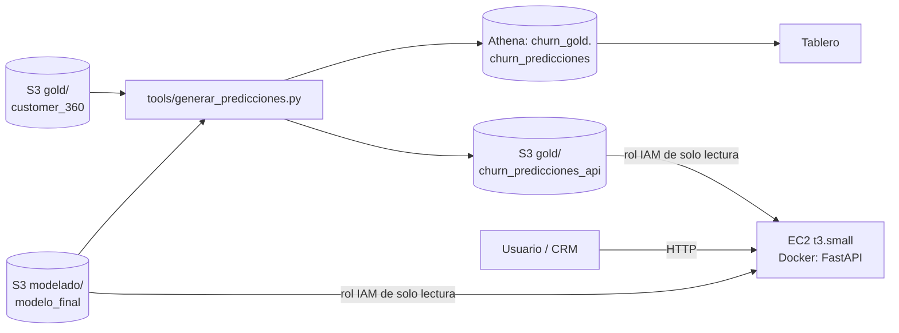

# API de churn y tabla de predicciones

Despliegue del modelo final (fase de **despliegue** de CRISP-DM): una API REST que puntúa y explica clientes, y la
tabla `churn_gold.churn_predicciones` con la probabilidad de churn de los 500.000 clientes, que alimenta el tablero.
Ambas usan las funciones de `src/churn/modelos.py`, así que dan los mismos resultados que `02_modelado.ipynb` y
`03_xai.ipynb`.

| Pieza | Archivo | Estado |
|---|---|---|
| API (FastAPI) | `api/app.py` | Probada en local (sección 6) |
| Imagen Docker | `api/Dockerfile`, `api/requirements.txt`, `.dockerignore`, `tools/empaquetar_api.py` | Escrita, falta construirla en EC2 |
| Tabla de predicciones | `tools/generar_predicciones.py` → `churn_gold.churn_predicciones` | Creada y verificada en Athena |
| Despliegue en EC2 | Sección 5 | Pendiente |

## 1. Arquitectura



- **Por lotes:** `generar_predicciones.py` puntúa y explica a todos los clientes y escribe la tabla en la capa oro.
- **En línea:** la API recibe las 4 variables de un cliente (nuevo o existente) y responde al momento. También
  devuelve la fila ya calculada de un cliente existente por su `customer_id`.
- El modelo no se reentrena. Se descarga de `s3://<bucket>/modelado/modelo_final/` con `modelos.cargar_modelo_final()`.

## 2. Requisitos

- **Python 3.12.** `requirements.txt` incluye `xgboost==3.4.1`, que no instala con 3.11.
- Las versiones del modelo no se cambian: `interpret-core==0.7.8`, `scikit-learn==1.9.1`, `pandas==3.1.0` y
  `numpy==2.4.6` (clave `versiones` de `configuracion.json`). Con otras, el `joblib` puede no cargar o dar otros
  resultados.
- El `.env` de `docs/02_conexion_aws.md`, con un usuario que pueda **escribir** en S3 y crear tablas en Athena
  (solo para generar la tabla). El usuario de solo lectura de esa guía sirve para la API en local.

```powershell
python -m venv C:\venvs\outliers          # fuera de OneDrive si el repo está ahí
C:\venvs\outliers\Scripts\Activate.ps1
pip install -r requirements.txt
pip install fastapi "uvicorn[standard]"
python tools/verificar_conexion.py
```

## 3. Tabla `churn_gold.churn_predicciones`

Una fila por cliente. Se genera con:

```powershell
$env:PYTHONPATH = "src"
python tools/generar_predicciones.py
```

El script borra lo que haya en `gold/churn_predicciones/`, sube un Parquet nuevo y vuelve a crear la tabla, así que
se puede repetir sin duplicar filas. Además deja una copia en `gold/churn_predicciones_api/` para la API.

| Columna | Tipo | Qué es |
|---|---|---|
| `customer_id` | bigint | Llave para unir con `customer_360` |
| `conjunto` | string | `train` o `test`, de `data.cargar_particion` |
| `probabilidad` | double | Probabilidad de churn del EBM |
| `churn_predicho` | int | 1 si `probabilidad` ≥ 0,5 |
| `prioridad` | int | Orden de `modelos.priorizar`: 1 es el cliente de mayor riesgo |
| `motivo_principal` | string | Término del EBM que más riesgo le suma. Nulo si ninguno suma |
| `campana_sugerida` | string | Reactivación o atención posventa (decisión 24 de `modelado_decisiones.md`) |
| `contribucion_pedidos` | double | Aporte de `summary_total_orders` al log-odds |
| `contribucion_gasto` | double | Aporte de `total_spent` |
| `contribucion_valor_promedio` | double | Aporte de `average_order_value` |
| `contribucion_devoluciones` | double | Aporte de `total_returns` |
| `contribucion_pedidos_devoluciones` | double | Aporte de la interacción pedidos × devoluciones |
| `modelo` | string | `EBM` |
| `umbral` | double | 0,5 |
| `fecha_prediccion` | date | Día en que se generó |

`lifetime_value`, el `churn` real y el perfil no se repiten: el tablero los une desde `customer_360` por `customer_id`.
Las contribuciones se renombran porque Athena no admite espacios ni `&` en los nombres de columna.

**Verificación (11 nov 2026)**

| Control | Esperado | Obtenido |
|---|---|---|
| Filas y `customer_id` únicos | 500.000 | 500.000 y 500.000 |
| Clientes con `churn_predicho = 1` | 43.375 | 43.375 |
| Clientes en `test` | 150.000 | 150.000 |
| ROC-AUC con `conjunto = 'test'` | 0,7811 | 0,7811 |
| Probabilidad de la tabla frente a `modelos.predecir` (200 clientes al azar) | Igual | Diferencia máxima de 1,1e-16 |

```sql
SELECT count(*), count(DISTINCT customer_id), sum(churn_predicho) FROM churn_gold.churn_predicciones;
```

**Cuidados al usarla**

- Los clientes de `train` tienen probabilidades dentro de muestra, porque el modelo se entrenó con ellos. Las métricas
  de desempeño se calculan solo con `conjunto = 'test'`.
- 2.210 clientes no tienen `motivo_principal` (ningún término les suma riesgo) y 57.670 no tienen
  `campana_sugerida`: además de esos 2.210, los 55.460 cuyo motivo es `average_order_value`, que no tiene campaña
  propia (decisión 24).
- **Formato:** es una tabla externa sobre Parquet, no Iceberg como el resto de oro. La primera versión del script usaba
  `wr.athena.to_iceberg` y falló con `RecursionError`. La causa es el **orden de los `import`**: `src/churn/data.py`
  activa `truststore` al importarse, y si `awswrangler` se importa antes que `churn.data`, crear un cliente de AWS
  entra en un bucle (comprobado con `wr.athena.get_work_group`: falla con `awswrangler` primero y funciona con
  `churn.data` primero). Por eso `leer_athena` no tiene el problema: importa `awswrangler` dentro de la función.
  No se probó escribir Iceberg con el orden corregido. Se dejó Parquet externo porque la tabla se reescribe completa en
  cada corrida y Iceberg no aporta ventajas aquí. Quien escriba otra tabla con `awswrangler` debe importar `churn.data`
  primero.

## 4. API

### Correrla en local

```powershell
$env:PYTHONPATH = "src"
uvicorn api.app:app --reload
```

Documentación interactiva (Swagger) en `http://127.0.0.1:8000/docs`. El modelo se carga una sola vez, al iniciar. Si
existe `data/churn_predicciones.parquet` (lo deja `generar_predicciones.py`), también se carga para `/clientes/{id}`.

### Endpoints

| Método y ruta | Función de `churn.modelos` | Devuelve |
|---|---|---|
| `GET /salud` | — | Estado, modelo, variables, umbral, métricas y si está activa la búsqueda por `customer_id` |
| `GET /modelo` | — | Configuración del modelo: variables, retiradas por fuga, hiperparámetros, métricas y versiones |
| `POST /predecir` | `predecir` | Probabilidad y `churn_predicho` de 1 a 1.000 clientes |
| `POST /explicar` | `explicar_cliente` | Contribuciones, log-odds, motivo principal y campaña de un cliente |
| `POST /contrafactuales` | `contrafactuales` | Cambios que dejan al cliente bajo 0,5, con una y con dos variables, y la meta |
| `GET /clientes/{customer_id}` | — | Fila de `churn_predicciones` de un cliente existente |

**Entrada de un cliente** (`/predecir` recibe una lista; `/explicar` y `/contrafactuales`, uno solo):

```json
{"customer_id": 1003776, "summary_total_orders": 66, "total_spent": 438545.58,
 "average_order_value": 6644.63, "total_returns": 3}
```

**Respuesta de `/predecir`:**

```json
[{"probabilidad": 0.10436110976384445, "churn_predicho": 0, "customer_id": 1003776, "advertencias": []}]
```

### Validaciones

| Caso | Respuesta |
|---|---|
| Falta una de las 4 variables, o no es numérica | 422 |
| Pedidos o valor promedio ≤ 0, o gasto o devoluciones negativos | 422 |
| `total_returns` mayor que `summary_total_orders` | 422 |
| Lista vacía o de más de 1.000 clientes en `/predecir` | 422 |
| Valor fuera del rango de entrenamiento (pedidos 1–120, devoluciones 0–10, valor promedio 500,12–11.999,99, gasto 502,27–1.439.544) | 200, con una advertencia: fuera del rango el EBM repite el valor del extremo |
| `total_spent` distinto de pedidos × valor promedio (más de 1 %) | 200, con una advertencia |
| `customer_id` que no existe en `/clientes/{id}` | 404 |

Los `NaN` de `contrafactuales` (por ejemplo, cuando una variable no logra bajar del umbral) se devuelven como `null`.

## 5. Despliegue en EC2 (pendiente de ejecutar)

La imagen copia `src/churn/` y `api/`, pero no el modelo ni credenciales: el modelo y la copia de la tabla se montan al
ejecutar, y la instancia los lee de S3 con un rol IAM. `.dockerignore` deja fuera `.env`, `data/` y los notebooks.

1. **Rol de la instancia.** IAM → Roles → Create role → AWS service → EC2, sin políticas, nombre `outliers-ec2-api`.
   Política en línea (cambia el bucket):

   ```json
   {
     "Version": "2012-10-17",
     "Statement": [
       {"Effect": "Allow", "Action": "s3:ListBucket",
        "Resource": "arn:aws:s3:::NOMBRE-DEL-BUCKET",
        "Condition": {"StringLike": {"s3:prefix": ["modelado/modelo_final/*", "gold/churn_predicciones_api/*",
                                                    "despliegue/*"]}}},
       {"Effect": "Allow", "Action": "s3:GetObject",
        "Resource": ["arn:aws:s3:::NOMBRE-DEL-BUCKET/modelado/modelo_final/*",
                     "arn:aws:s3:::NOMBRE-DEL-BUCKET/gold/churn_predicciones_api/*",
                     "arn:aws:s3:::NOMBRE-DEL-BUCKET/despliegue/*"]}
     ]
   }
   ```

2. **Instancia.** Amazon Linux 2023, `t3.small`, sin key pair (conexión por EC2 Instance Connect), IP pública,
   16 GB gp3, perfil `outliers-ec2-api`. Security group: SSH (22) para Instance Connect y TCP 8000 desde *My IP*.

3. **Instalación** (en la terminal de Instance Connect):

   ```bash
   sudo dnf install -y docker unzip
   sudo systemctl enable --now docker
   sudo usermod -aG docker ec2-user
   exit
   # vuelve a conectarte
   # El repo es privado, así que la instancia no lo clona: descarga el código empaquetado en S3
   # (en tu equipo: python tools/empaquetar_api.py --subir)
   mkdir churn-api && cd churn-api
   aws s3 cp s3://NOMBRE-DEL-BUCKET/despliegue/churn-api.zip . && unzip churn-api.zip
   aws s3 cp s3://NOMBRE-DEL-BUCKET/modelado/modelo_final/ ./modelo/ --recursive
   aws s3 cp s3://NOMBRE-DEL-BUCKET/gold/churn_predicciones_api/churn_predicciones.parquet .
   docker build -f api/Dockerfile -t churn-api .
   docker run -d --name churn-api --restart unless-stopped -p 8000:8000 \
     -v "$(pwd)/modelo:/app/data/modelado/modelo_final:ro" \
     -v "$(pwd)/churn_predicciones.parquet:/app/data/churn_predicciones.parquet:ro" \
     churn-api
   curl http://localhost:8000/salud
   ```

4. **Prueba** desde otro equipo en `http://<ip-publica>:8000/docs`.

5. **Costo.** `t3.small` cuesta cerca de 0,02 USD por hora más la IP pública. Detén la instancia cuando no se use;
   al encenderla cambia la IP y el contenedor arranca solo. Al terminar el proyecto, termínala y borra el rol.

## 6. Pruebas realizadas (11 nov 2026, en local)

Con el cliente de pruebas de FastAPI y el modelo descargado de S3, 25 de 25 chequeos pasaron:

- `/salud` y `/modelo` responden con el EBM, sus 4 variables, métricas y versiones.
- `/predecir` con 200 clientes reales al azar da la misma probabilidad que `modelos.predecir` (diferencia máxima de 0).
- `/explicar` devuelve motivo y campaña; `/contrafactuales` devuelve la meta para un cliente de alto riesgo, responde
  `bajo_umbral` para uno de bajo riesgo y no deja `NaN` en el JSON.
- `/clientes/{id}` responde 200 para un cliente existente y 404 para uno inexistente.
- Las validaciones de la sección 4 dan 422 o advertencia según corresponde.

También se comprobó que la API arranca y responde en un entorno limpio con **solo** `api/requirements.txt` (lo mismo
que tendrá la imagen), sin `awswrangler`, `matplotlib` ni `xgboost`.

No se ha probado: la construcción de la imagen Docker (no hay Docker en el equipo local) ni el despliegue en EC2.

## 7. Qué decir y qué no

- Las explicaciones describen **cómo decide el modelo**, no por qué abandonan los clientes. Los contrafactuales no
  garantizan que un cambio retenga al cliente.
- Los datos son sintéticos y puede quedar parte de la señal de la etiqueta en las 4 variables (decisión 11 de
  `docs/modelado_decisiones.md`), así que el ROC-AUC de 0,78 puede sobrestimar la capacidad real.
- La probabilidad no está calibrada: sirve para ordenar clientes y para el umbral de 0,5, no para afirmar que "el X %
  de estos clientes se va a ir".
- La API no tiene autenticación ni HTTPS. Es una demostración con datos sintéticos.

## 8. Escenario de producción (hipotético)

- Pedidos y tickets nuevos llegarían en streaming (Kinesis), y `customer_360` se recalcularía por lotes.
- `generar_predicciones.py` se programaría (EventBridge con Glue o Lambda) después de cada recálculo.
- La API iría detrás de un balanceador con HTTPS y autenticación, con varias réplicas (ECS o EKS).
- El modelo se versionaría en un registro (MLflow Model Registry) y se vigilaría la deriva de las 4 variables frente a
  los rangos de entrenamiento, que la API ya reporta como advertencias.
